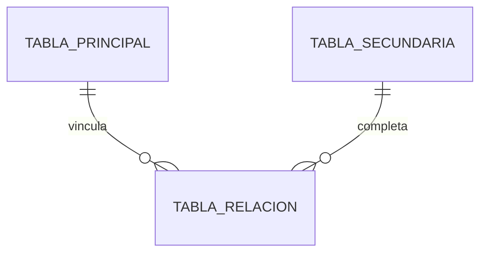

# Modelo ER

## Alcance del modelo

Explicá el modelo lógico que respalda la API y el flujo de prueba. Si no entregás `schema.sql`, este artefacto sigue siendo la referencia de diseño.

## Entidades y relaciones

| Elemento | Tipo | Evidencia visible | Observación |
| --- | --- | --- | --- |
| `Entidad A` | Entidad | HU-01, HU-02, HU-03 | representa el objeto principal del flujo |
| `Entidad B` | Entidad | HU-01, HU-02 | representa el recurso relacionado |
| `Relación AB` | Entidad asociativa | HU-01, HU-02, HU-03 | conserva el vínculo entre A, B y el estado del vínculo |

## Correspondencia DER

La correspondencia entre el modelo y el diseño relacional debe quedar explícita. Escribí la referencia técnica como `tabla.columna`.

| Tabla | Columna | Clave | Origen en dominio | Correspondencia técnica | Justificación |
| --- | --- | --- | --- | --- | --- |
| `tabla_principal` | `id_tabla_principal` | `PK` | `Entidad A` | `tabla_principal.id_tabla_principal` | identifica el agregado principal |
| `tabla_secundaria` | `id_tabla_secundaria` | `PK` | `Entidad B` | `tabla_secundaria.id_tabla_secundaria` | identifica el segundo objeto del flujo |
| `tabla_relacion` | `id_tabla_relacion` | `PK` | `Relación AB` | `tabla_relacion.id_tabla_relacion` | identifica la relación persistida |
| `tabla_relacion` | `id_tabla_principal` | `FK` | `Relación AB -> Entidad A` | `tabla_principal.id_tabla_principal` | materializa la referencia al objeto principal |
| `tabla_relacion` | `id_tabla_secundaria` | `FK` | `Relación AB -> Entidad B` | `tabla_secundaria.id_tabla_secundaria` | materializa la referencia al objeto relacionado |

Reglas para completar esta tabla:

- cada fila con `PK` o `FK` debe tener `Origen en dominio`, `Correspondencia técnica` y `Justificación`;
- no dejes claves genéricas sin correspondencia explícita;
- si una tabla puente o asociativa no tiene atributos propios, preferí una PK compuesta por sus FKs o justificá la excepción;
- cada `FK` debe apuntar a la `PK` de otra tabla.

## Trazabilidad

| Elemento DER | Historia / feature | Evidencia |
| --- | --- | --- |
| `Entidad A` | `HU-01`, `HU-02`, `HU-03` | la API y las stories concretas la usan como referencia principal |
| `Entidad B` | `HU-01` | disponibilidad, alta y reconsulta sobre el recurso relacionado |
| `Relación AB` | `HU-02`, `HU-03` | creación, confirmación y cancelación del vínculo |

