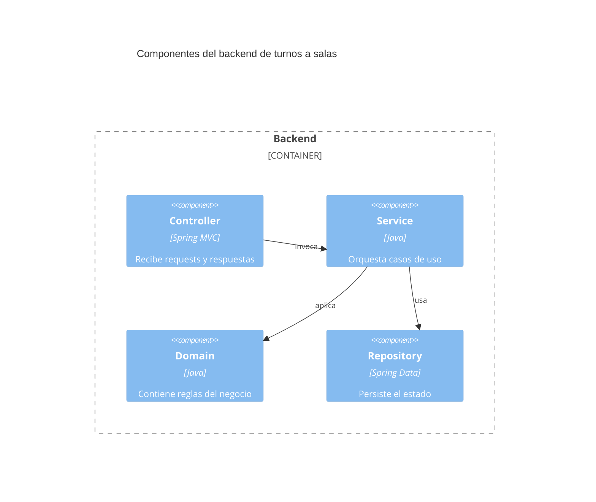

# C4 - Componentes

Usar Mermaid inline con sintaxis `C4Component`.

## Propósito

Describir la separacion logica por capas del backend del sistema de gestion de turnos a salas.

## Componentes principales

| Componente | Responsabilidad | Interacciones |
| --- | --- | --- |
| Controller | Recibe requests y responde | Service |
| Service | Orquesta casos de uso | Domain, Repository |
| Domain | Encapsula reglas del negocio | Service |
| Repository | Persiste y recupera datos | Service |

## Diagrama

## Riesgos o limites del diseno

- No bajar a clases concretas ni wiring de framework.
- La capa de dominio debe seguir siendo conceptual, no una copia del codigo.
