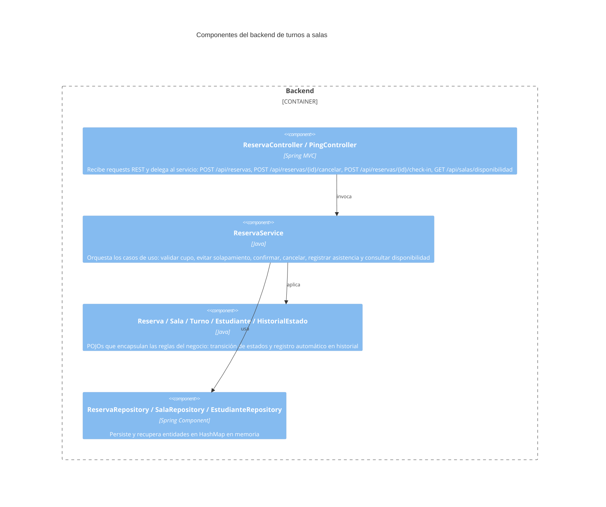

# C4 - Componentes
Usar Mermaid inline con sintaxis `C4Component`.

## Propósito
Describir la separación lógica por capas del backend del sistema de gestión de turnos a salas.

## Componentes principales

| Componente | Responsabilidad | Interacciones |
| --- | --- | --- |
| Controller | Recibe requests HTTP y devuelve respuestas REST JSON | Service |
| Service | Orquesta los casos de uso y aplica las reglas de negocio | Domain, Repository |
| Domain | Encapsula las reglas del negocio (estados de reserva, historial, cupo) | Service |
| Repository | Persiste y recupera entidades en memoria | Service |

## Diagrama

## Riesgos o límites del diseño
- No bajar a clases concretas ni wiring de framework.
- La capa de dominio debe seguir siendo conceptual, no una copia del código.
- Los repositorios HashMap no son thread-safe; son válidos para esta iteración pero deberán reemplazarse con Spring Data JPA en producción.