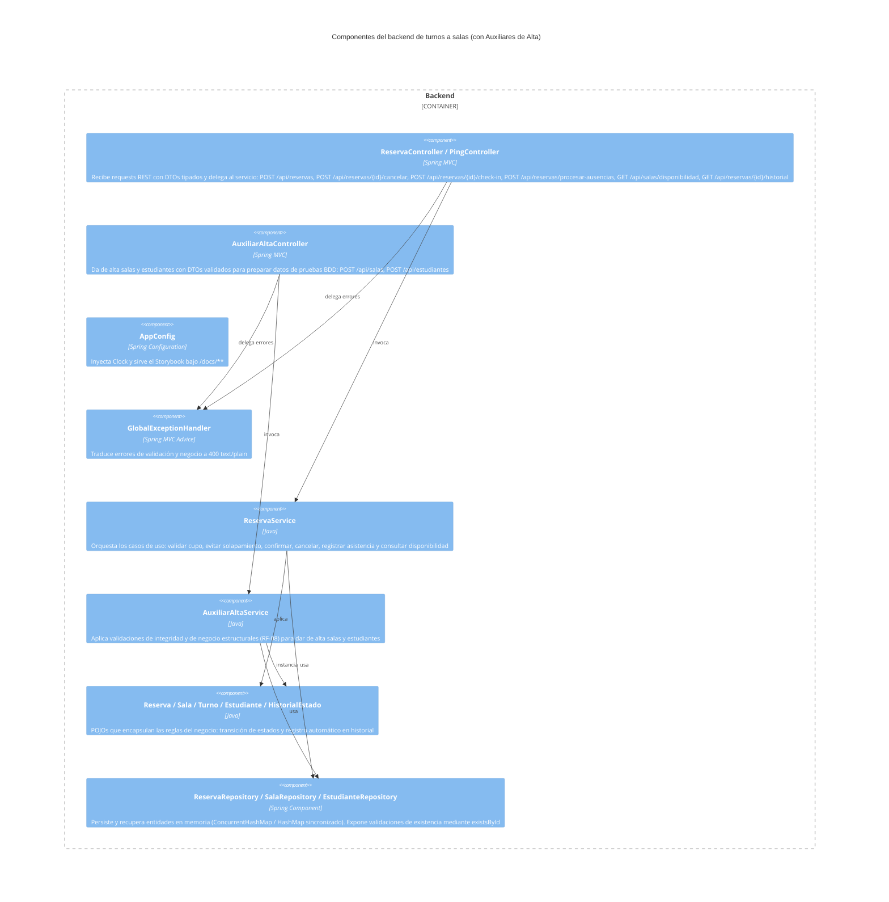

# C4 - Componentes

## Propósito

Describir la separación lógica por capas del backend del sistema de gestión de turnos a salas, incluyendo los componentes principales y los auxiliares de pruebas.

## Componentes principales

| Componente | Responsabilidad | Interacciones |
| --- | --- | --- |
| Controller | Recibe requests HTTP, valida DTOs con Bean Validation, delega en el servicio y devuelve respuestas REST coherentes (`200 OK` o `400 Bad Request`). | Service |
| Service | Orquesta los casos de uso, aplica reglas de negocio, valida formato de fecha/hora y usa un `Clock` inyectado para procesar ausencias de forma determinista. | Domain, Repository |
| Domain | Encapsula reglas de negocio: invariantes de Sala/Turno/Personal, transiciones de estado de Reserva e historial inmutable. `Turno` sigue embebido en `Reserva` en esta iteración. | Service |
| Repository | Persiste y recupera entidades en memoria (`ConcurrentHashMap` o `HashMap` con sincronización). `ReservaRepository` sincroniza métodos críticos y `SalaRepository`/`EstudianteRepository` usan `ConcurrentHashMap`. | Service |
| Config | `AppConfig` registra el `Clock` del sistema y publica el Storybook estático bajo `/docs/**`. | Controllers |
| Error handling | `GlobalExceptionHandler` normaliza errores de validación, recurso inexistente y reglas de negocio a `400 text/plain`. | Controllers |

## Diagrama

## Riesgos o límites del diseño
 - Persistencia en memoria: los repositorios usan colecciones Java, lo que implica limitaciones en concurrencia y durabilidad. En la implementación actual se mitigó parte del riesgo aplicando sincronización (`synchronized`) en los métodos críticos y `ConcurrentHashMap` en salas/estudiantes, pero esto no reemplaza garantías transaccionales ni la durabilidad de una base de datos relacional. En producción se reemplazará por Spring Data JPA; `db/schema.sql` deja preparado el esquema relacional.
 - La disponibilidad se calcula por fecha y sala (inventario diario), no por bloque horario individual. El control de cupo por bloque se aplica al crear la reserva.
