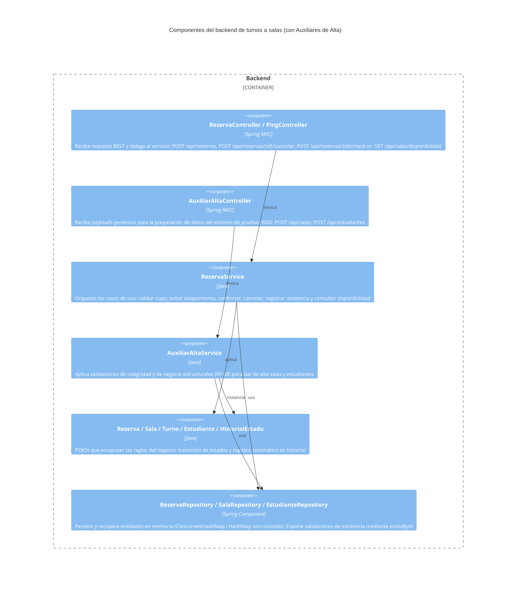

# C4 - Componentes

## Propósito

Describir la separación lógica por capas del backend del sistema de gestión de turnos a salas, incluyendo los componentes principales y los auxiliares de pruebas.

## Componentes principales

| Componente | Responsabilidad | Interacciones |
| --- | --- | --- |
| Controller | Recibe requests HTTP, valida firmas genéricas de entrada (`Map`) y devuelve respuestas REST JSON coherentes (`200 OK` o `400 Bad Request`).| Service | 
| Service | Orquesta los casos de uso principales, extrae tipados seguros y aplica rigurosamente las reglas de negocio. | Domain, Repository |
| Domain | Encapsula las reglas del negocio (estados de reserva, historial, cupo). Nota: el objeto `Turno` hoy está modelado como un valor embebido dentro de `Reserva` (no tiene id persistido en esta iteración). | Service |
| Repository | Persiste y recupera entidades mediante estructuras de datos en memoria (implementadas como `ConcurrentHashMap` o `HashMap` con sincronización). En la implementación actual `ReservaRepository` aplica sincronización en métodos críticos y `SalaRepository`/`EstudianteRepository` usan `ConcurrentHashMap` para reducir riesgos de condiciones de carrera. | Service |

## Diagrama

## Riesgos o limites del diseno
 - Persistencia en memoria: los repositorios usan HashMap, lo que implica limitaciones en concurrencia y durabilidad. En la implementación actual se mitigó parte del riesgo aplicando sincronización (`synchronized`) en los métodos críticos de los repositorios, pero esto no reemplaza garantías transaccionales ni la durabilidad de una base de datos relacional. En producción se reemplazará por Spring Data JPA.
