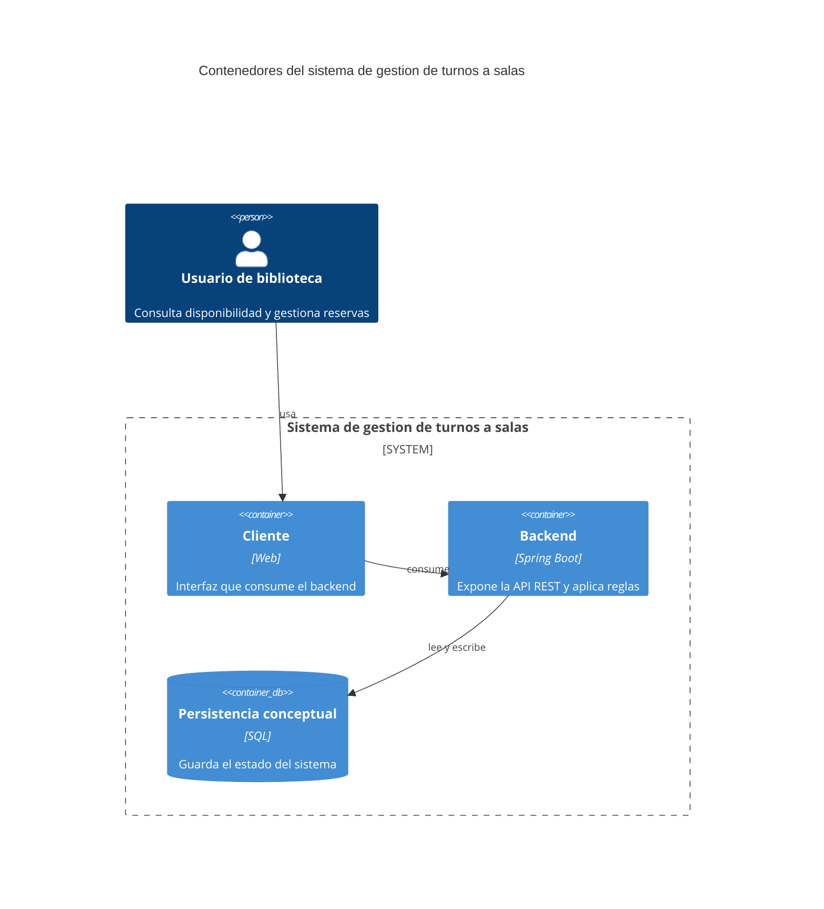

# C4 - Contenedores

Usar Mermaid inline con sintaxis `C4Container`.

## Propósito

Explicar el recorte de contenedores del sistema de gestion de turnos a salas de la biblioteca: cliente, backend y persistencia conceptual.

## Contenedores

| Contenedor | Responsabilidad | Tecnología |
| --- | --- | --- |
| Cliente | Interactua con la solucion | Web |
| Backend | Expone la API REST y aplica reglas | Spring Boot |
| Persistencia conceptual | Guarda el estado del sistema | SQL |

## Diagrama

## Decisiones relevantes

- El backend concentra la logica de aplicacion.
- La persistencia se muestra como recorte conceptual, no como detalle de implementacion.
