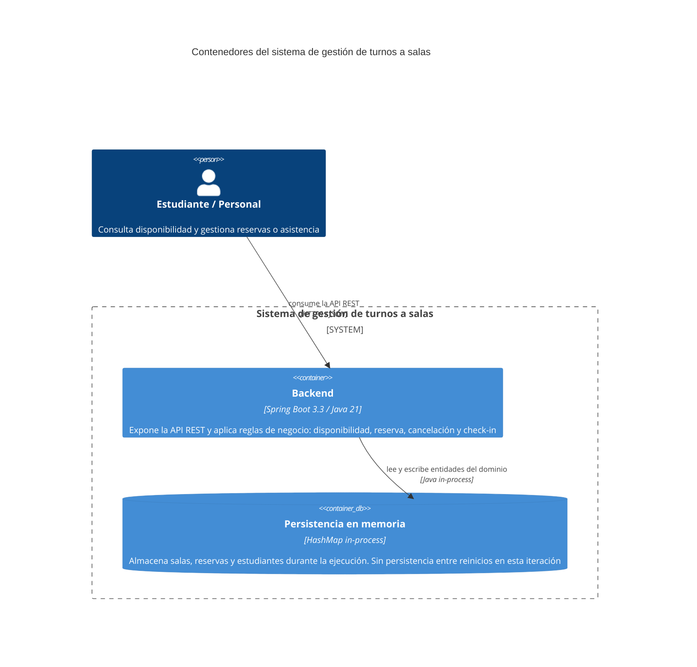

# C4 - Contenedores
Usar Mermaid inline con sintaxis `C4Container`.

## Propósito
Explicar el recorte de contenedores del sistema de gestión de turnos a salas de la biblioteca: actores, backend y persistencia en memoria.

## Contenedores

| Contenedor | Responsabilidad | Tecnología |
| --- | --- | --- |
| Backend | Expone la API REST y aplica las reglas de negocio del dominio | Spring Boot 3.3 / Java 21 |
| Persistencia en memoria | Guarda el estado de salas, reservas y estudiantes durante la ejecución | HashMap in-process (sin base de datos externa en esta iteración) |

## Diagrama

## Decisiones relevantes
- El backend concentra toda la lógica de aplicación y dominio.
- La persistencia se implementa en memoria (HashMap) para eliminar dependencias de entorno en esta iteración. En una iteración posterior se reemplazaría por Spring Data JPA con H2 o PostgreSQL.
- No existe capa de cliente en esta iteración; los consumidores acceden directamente a la API REST.