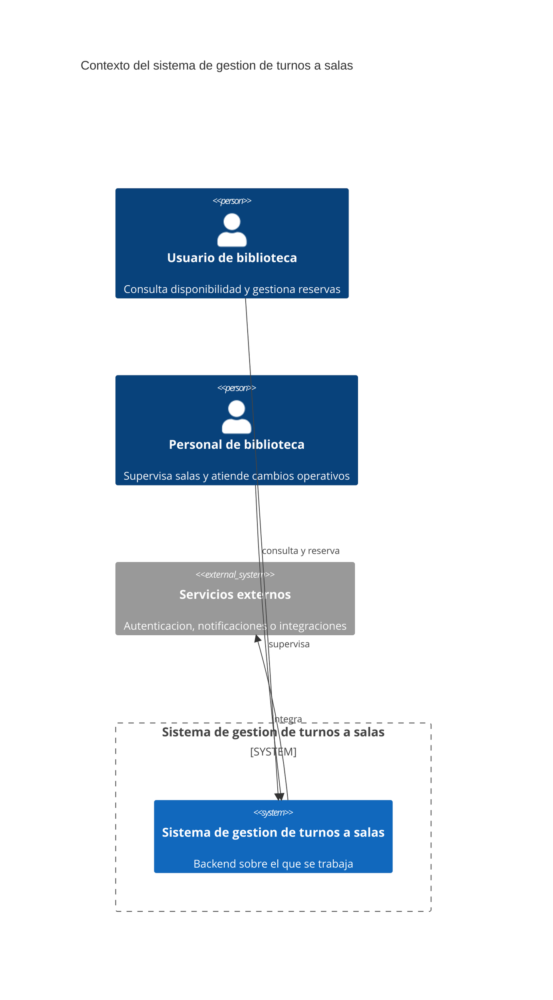

# C4 - Contexto

Usar Mermaid inline con sintaxis `C4Context`.

## Propósito

Explicar el contexto del sistema de gestion de turnos a salas de la biblioteca con actores, sistema bajo estudio y relaciones relevantes.

## Sistema analizado

El sistema bajo estudio es el backend que administra disponibilidades, reservas y cancelaciones de salas.

## Actores y sistemas externos

| Elemento | Tipo | Interacción |
| --- | --- | --- |
| Usuario de biblioteca | Actor | Consulta disponibilidad y gestiona reservas. |
| Personal de biblioteca | Actor | Supervisa salas y atiende cambios operativos. |
| Servicios externos | Sistema externo | Acompanan autenticacion, notificaciones o integraciones. |

## Diagrama

## Notas

- El foco esta en identificar actores, sistema y relaciones.
- No se reemplaza el contexto con un diagrama generico.
