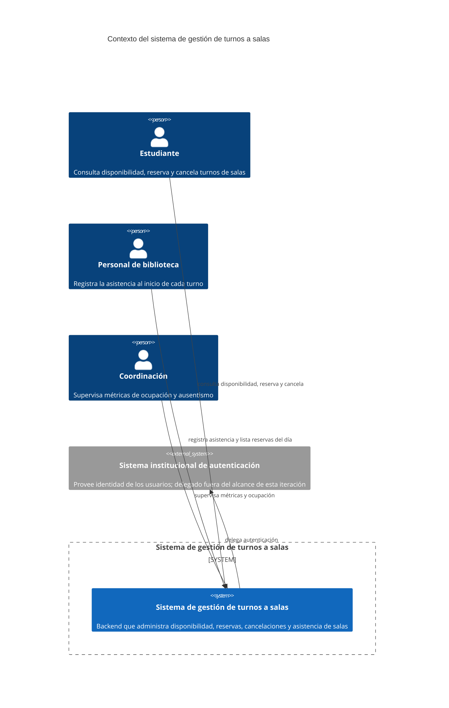

# C4 - Contexto
Usar Mermaid inline con sintaxis `C4Context`.

## Propósito
Explicar el contexto del sistema de gestión de turnos a salas de la biblioteca con actores, sistema bajo estudio y relaciones relevantes.

## Sistema analizado
El sistema bajo estudio es el backend que administra disponibilidades, reservas y cancelaciones de salas de la biblioteca académica.

## Actores y sistemas externos

| Elemento | Tipo | Interacción |
| --- | --- | --- |
| Estudiante | Actor | Consulta disponibilidad de salas, reserva turnos y cancela reservas propias. |
| Personal de biblioteca | Actor | Registra la asistencia (check-in) de estudiantes al inicio de cada turno. |
| Coordinación | Actor | Supervisa métricas de ocupación y ausentismo para toma de decisiones operativas. |
| Sistema institucional de autenticación | Sistema externo | Provee identidad de los usuarios. Delegado fuera del alcance de esta iteración. |

## Diagrama

## Notas
- El foco está en identificar actores, sistema y relaciones.
- La autenticación está fuera del alcance de esta iteración (RN-08); el sistema asume usuarios ya autenticados.
- No se reemplaza el contexto con un diagrama genérico.