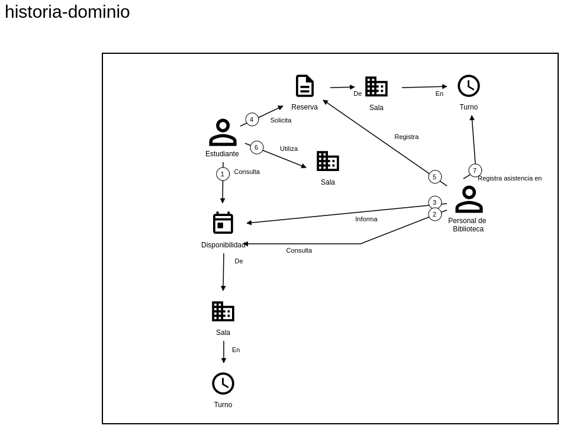

# Historia de dominio

## Escenario elegido

Reserva y uso de una sala de estudio por parte de un estudiante.

---

## Recorte aplicado

Se modela el proceso en condiciones normales (happy path), enfocándose en el dominio.

No se incluyen:
- cancelaciones  
- conflictos  
- excepciones  
- detalles de implementación  

---

## Actores

- Estudiante  
- Personal de biblioteca  

---

## Objetos de trabajo

- Sala  
- Turno  
- Reserva  
- Disponibilidad  

---

## Historia paso a paso

1. El estudiante consulta la disponibilidad de salas para un turno determinado.  
2. El personal consulta la disponibilidad de salas.  
3. El personal informa las opciones disponibles.  
4. El estudiante solicita la reserva de una sala y turno.  
5. El personal registra la reserva.  
6. El estudiante hace uso de la sala en el turno reservado.  
7. El personal registra la asistencia del estudiante al turno.

---

## Dudas y supuestos

- La disponibilidad refleja el estado actual.  
- No se consideran conflictos concurrentes.  
- No se incluyen cancelaciones ni ausencias.  
- La asistencia es registrada por el personal al inicio del turno.  

---

## Criterios de control

- Se modela un único escenario.  
- Se describe el dominio (no la solución).  
- Se sigue el flujo completo (reserva + uso + registro de asistencia).