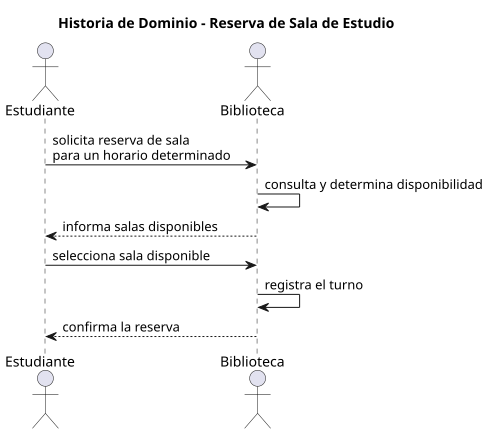

# Historia de dominio
## Escenario elegido
Reserva de una sala de estudio por parte de un estudiante.
---
## Recorte aplicado
Se modela el proceso de reserva de un turno en condiciones normales (happy path), enfocándose en el dominio del problema.
No se incluyen:
- detalles de implementación (manual o digital)  
- cancelaciones  
- conflictos o excepciones  
- métricas o análisis  
---
## Actores
- Estudiante
- Biblioteca
---
## Objetos de trabajo
- Sala
- Turno
- Disponibilidad
- Reserva
---
## Historia paso a paso

1. El estudiante solicita la reserva de una sala de estudio para un horario determinado.  
2. Se consulta y determina la disponibilidad de la sala solicitada.  
3. El estudiante selecciona una sala disponible.  
4. Se registra la reserva del turno.  
5. El turno queda confirmado para el estudiante.  
---
## Dudas y supuestos
- Se asume que la disponibilidad refleja el estado actual de las salas.  
- No se consideran cambios concurrentes en la disponibilidad durante el proceso.  
- No se incluyen reglas de negocio como límites de reservas por usuario.  
- No se contemplan cancelaciones ni ausencias.  
---
## Criterios de control
- Se modela un único escenario (reserva de turno)  
- Se describe el dominio sin depender de una implementación específica  
- Se mantiene el flujo principal (happy path)
 