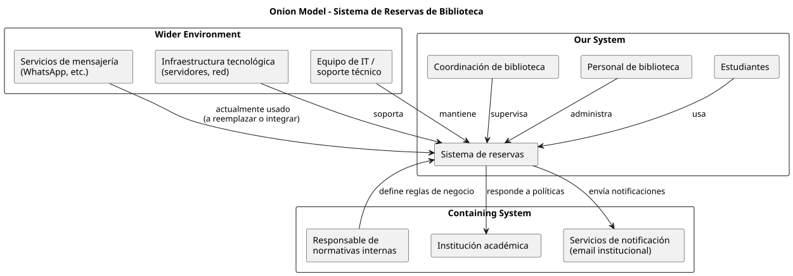

# Interesados

Archivos companion esperados:

- `docs/descubrimiento/interesados.drawio` o `docs/descubrimiento/interesados.puml`
- `docs/descubrimiento/interesados.svg` o `docs/descubrimiento/interesados.png`

## Sistema analizado

...

## Criterio de capas

- `Our System`
- `Containing System`
- `Wider Environment`

...

## Resumen del modelo

...

## Registro de interesados

| ID | Interesado | Capa | Relación con el sistema | Justificación | Estado |
| --- | --- | --- | --- | --- | --- |
| I-01 | ... | Our System | ... | ... | explícito |

## Cobertura faltante

- ...

## Próximas acciones

- ...

## Criterios de control

- no duplicar interesados;
- justificar por qué cada interesado queda en esa capa;
- marcar como `explícito`, `inferido` o `dudoso` según la evidencia disponible.
