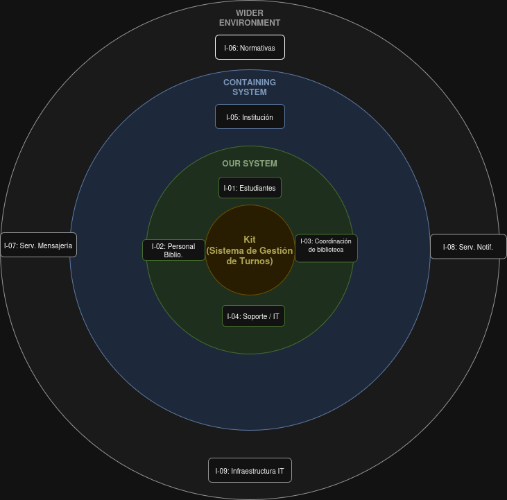

# Interesados (Onion Model)

## Sistema analizado

Sistema de gestión de turnos y reservas de salas para una biblioteca académica.

El sistema propuesto reemplazará el proceso manual actual (planillas, mails y mensajería), permitiendo centralizar la gestión, evitar errores y mejorar la experiencia de los usuarios.

---

## Criterio de capas

Se utiliza el modelo de capas tipo *Onion Model*:

- **Our System:** actores que interactúan directamente con el sistema.
- **Containing System:** entorno organizacional donde el sistema opera.
- **Wider Environment:** actores externos o indirectos.

---

## Resumen del modelo

El núcleo del sistema está compuesto por los usuarios directos que operan el sistema: estudiantes, personal de biblioteca, coordinación y soporte técnico.

En la capa intermedia se encuentra la institución y las normativas que condicionan el funcionamiento.

En la capa externa se ubican los servicios y recursos tecnológicos que soportan el sistema.

---

## Registro de interesados

| ID   | Interesado                      | Capa              | Relación con el sistema                                      | Justificación                                                   | Estado     |
|------|--------------------------------|-------------------|---------------------------------------------------------------|------------------------------------------------------------------|------------|
| I-01 | Estudiantes                    | Our System        | Reservan turnos, consultan disponibilidad                     | Usuarios directos                                                | explícito  |
| I-02 | Personal de biblioteca         | Our System        | Gestiona reservas y conflictos                                | Operación diaria                                                 | explícito  |
| I-03 | Coordinación de biblioteca     | Our System        | Supervisa uso y métricas                                      | Toma decisiones                                                  | explícito  |
| I-04 | Soporte / IT                  | Our System        | Mantiene el sistema operativo                                 | Necesario para funcionamiento                                   | inferido   |
| I-05 | Institución académica          | Containing System | Define políticas generales                                    | Contexto organizacional                                          | inferido   |
| I-06 | Normativas internas            | Wider Environment| Regulan uso de salas                                          | Condicionan reglas del sistema                                   | inferido   |
| I-07 | Servicios de mensajería        | Wider Environment | Canal actual de comunicación                                  | Puede integrarse o eliminarse                                   | dudoso  |
| I-08 | Servicios de notificación      | Wider Environment | Envío de mensajes (email, etc.)                               | Soporte de comunicación                                         | inferido   |
| I-09 | Infraestructura tecnológica    | Wider Environment | Soporte técnico (servidores, red)                             | Necesaria para operación                                        | inferido   |

---

## Cobertura faltante

- Administradores del sistema (rol interno específico)
- Detalle de integración con el sistema institucional de autenticación
- Umbral y duración de penalizaciones por ausencias (D-02)

---

## Próximas acciones

- Validar interesados con actores reales  
- Confirmar roles técnicos  
- confirmar si se va a integrar servicios de mensajeria como whatsapp
- Evaluar integraciones externas  

---

## Criterios de control

- No duplicar interesados  
- Justificar cada capa  
- Clasificar como:
  - explícito  
  - inferido  
  - dudoso  