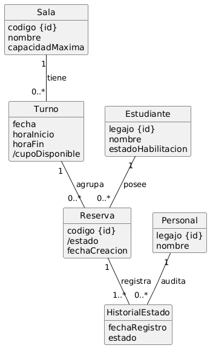

# Modelo de Dominio Conceptual

## Archivo fuente y export visual

- **Archivo editable:** `docs/requisitos/modelo-dominio.puml`
- **Export visual:** `docs/requisitos/modelo-dominio.png`
- **Documento de contexto:** `docs/requisitos/modelo-dominio.md`

---

## Alcance del modelo

Cubre el ciclo de vida de una reserva de sala de estudio desde su creación, consulta de disponibilidad en tiempo real, hasta su resolución por uso efectivo, cancelación o ausencia, garantizando trazabilidad total de auditoría y penalizaciones latentes.

**Incluye:** salas, turnos, estudiantes, personal de biblioteca, reservas e historial de estados.

## Fuera de alcance y exclusiones
- **Excluye:** submódulo de autenticación real de usuarios (RN-08), lógica algorítmica/automatizada de cálculo de suspensiones, navegación y componentes de UI.

---

## Inputs usados

- `docs/requisitos/requisitos.md`
- `src/test/resources/features/HU-01.feature`
- `src/test/resources/features/HU-02.feature`
- `src/test/resources/features/HU-03.feature`
- `src/test/resources/features/HU-04.feature`

---

## Historias priorizadas de referencia

| Historia | Recorte que aporta al modelo | Escenarios o evidencia usada |
| :--- | :--- | :--- |
| **HU-01** | Estructura de recursos y validación de capacidad | Reserva exitosa, capacidad máxima, FCFS y reserva duplicada |
| **HU-02** | Cálculo e inventario dinámico de disponibilidad pública | Consulta con salas libres, parcialmente ocupadas y sin cupos |
| **HU-03** | Ciclo de vida y liberación de cupo | Cancelación, liberación de turno, estados |
| **HU-04** | Trazabilidad de asistencia y ausencia automática | Check-in por personal, marcado automático, historial |

---

## Entidades conceptuales

| Entidad | Evidencia | Justificación (Enfoque Larman) |
| :--- | :--- | :--- |
| `Sala` | HU-01, HU-02, RF-08 | Recurso físico cuantificable con nombre y capacidad máxima definida. |
| `Turno` | HU-01, HU-02, RN-02 | Unidad conceptual reservable vinculada a una fecha y un bloque horario (`horaInicio`/`horaFin`). |
| `Estudiante` | HU-01, HU-03, HU-04, RN-10 | Sujeto central del sistema. Incorpora el estado de su condición para dar respuesta estructural a penalizaciones. |
| `Personal` | HU-04, HU-07 | Entidad requerida ante la necesidad de recordar (`need-to-remember`) qué agente auditó el check-in presencial. |
| `Reserva` | HU-01, HU-03, HU-04 | Transacción central que vincula un estudiante con un turno específico. |
| `HistorialEstado` | HU-04, RN-06, RN-09 | Registro inmutable de trazabilidad temporal para cada cambio de estado de la reserva. |

---

## Atributos

| Entidad | Atributos | Evidencia |
| :--- | :--- | :--- |
| `Sala` | `codigo {id}`, `nombre`, `capacidadMaxima` | RF-08, HU-01 ("Sala de Multimedia A", cap. 6) |
| `Turno` | `fecha`, `horaInicio`, `horaFin` | RN-02, HU-01, HU-02 (27/04/2026 de 10:00 a 11:00) |
| `Estudiante` | `legajo {id}`, `nombre`, `estadoHabilitacion` | HU-04 (EST-1042), RN-10, D-02 ("ACTIVO", "SUSPENDIDO") |
| `Personal` | `legajo {id}`, `nombre` | HU-04 ("Ana Pérez", Personal de biblioteca) |
| `Reserva` | `codigo {id}`, `/estado`, `fechaCreacion` | RN-03, HU-01, HU-03 (RES-0892). El estado es derivado (`/`). |
| `HistorialEstado` | `fechaRegistro`, `estado` | HU-04, RN-06, RN-09 ("confirmada","presente", "ausente", "cancelada") |

---

## Relaciones persistidas

| Relación | Multiplicidad | Evidencia |
| :--- | :--- | :--- |
| `Sala` tiene `Turno` | 1 a 0..* | Una sala física expone múltiples bloques de atención en el calendario (RN-02). |
| `Turno` agrupa `Reserva` | 1 a 0..* | Un turno de sala acumula solicitudes hasta que las reservas activas igualen la capacidad (HU-01, HU-02). |
| `Estudiante` posee `Reserva` | 1 a 0..* | Un alumno posee transiciones asignadas. Se valida la no duplicación horaria en simultáneo (HU-01). |
| `Reserva` registra `HistorialEstado` | 1 a 1..* | Toda reserva nace con un estado inicial y se auditan sus mutaciones de ciclo de vida (RN-06). |
| `Personal` audita `HistorialEstado` | 1 a 0..* | El personal de biblioteca certifica presencialmente la transición hacia el estado "presente" (HU-04). |

---

## Decisiones de modelado y correcciones de pureza (Larman)

**Operario / relación con Personal (nota sobre implementación):**
En el nivel conceptual preferimos una asociación desde `HistorialEstado` hacia la entidad `Personal` cuando existe la necesidad de recordar quién auditó un cambio. Sin embargo, en la implementación actual se guarda el nombre del operario como un `String` dentro de `HistorialEstado` (campo `operario`) y la clase `Personal` existe en el dominio para facilitar la futura migración.

Esta decisión permite cumplir de forma inmediata los requisitos de trazabilidad sin introducir dependencias de persistencia adicionales en esta iteración. La intención es migrar la columna `legajo_personal` del DER a una referencia técnica (`FK`) hacia `personal(legajo)` cuando se adopte JPA/H2 o PostgreSQL en una iteración posterior.

**Modelado del `/estado` como atributo derivado en `Reserva`:**
Dado que el ciclo de vida de la reserva se registra de manera cronológica en la entidad `HistorialEstado`, el "estado actual" de la reserva no constituye un atributo primitivo estático. Se define con la barra `/` como un atributo calculado/derivado, cuyo valor real conceptual se obtiene navegando hacia el último registro del historial.

**Estructura Base para Penalizaciones (D-02 / HU-04):**
Atendiendo a la duda abierta D-02 y considerando que la HU-04 ya marca reservas como "ausente" de forma automática (generando el insumo base), se incorpora el atributo `estadoHabilitacion` dentro de la entidad `Estudiante` (valores iniciales: "ACTIVO", "SUSPENDIDO"). Esto materializa conceptualmente la regla en el dominio, dejando el modelo preparado para que la coordinación defina operativamente el umbral de ausencias sin requerir cambios estructurales futuros.

**Derivación de Cupos en Consulta en Tiempo Real (HU-02 / RF-08):**
La capacidad es una restricción física de la `Sala`. El atributo calculado `/cupoDisponible` expuesto en el caso de uso de consulta (HU-02) no se almacena de forma estática. Se deriva de manera dinámica restando la cantidad de reservas con estado activo contra la `capacidadMaxima` de la sala para el día determinado, garantizando la consistencia ante cambios edilicios.

---

## Trazabilidad

| Entidad | Historias | Requisitos |
| :--- | :--- | :--- |
| `Sala` | HU-01, HU-02 | RF-08, RN-01, RN-02 |
| `Turno` | HU-01, HU-02 | RN-02 |
| `Estudiante` | HU-01, HU-03, HU-04 | RN-10, RN-06, D-02 |
| `Personal` | HU-04 | HU-07 |
| `Reserva` | HU-01, HU-02, HU-03, HU-04 | RN-01, RN-03, RN-04, RN-06, RN-10 |
| `HistorialEstado` | HU-01, HU-03, HU-04 | RN-06, RN-09 |

---

## Dudas abiertas

| ID | Duda | Estado |
| :--- | :--- | :--- |
| D-02 | ¿Se aplicarán penalizaciones por ausencias acumuladas? | Mitigada. El dominio provee soporte estructural directo mediante el campo `estadoHabilitacion` de `Estudiante` y el registro de ausencias automáticas de `HistorialEstado`, listos para actuar cuando la coordinación fije la lógica reglamentaria. |

---

## Subset permitido de PlantUML

Usar `docs/requisitos/modelo-dominio.puml` con un diagrama de clases conceptual al estilo Larman. El subset permitido para este artefacto es:

- `class`
- atributos simples
- asociaciones con multiplicidad; si hace falta una etiqueta, debe nombrar el vínculo persistido y no una acción
- generalización solo si realmente aclara el dominio
- clase asociativa cuando la relación necesita atributos propios

Queda prohibido:

- métodos u operaciones
- visibilidades (`+`, `-`, `#`, `~`)
- `!include`
- `skinparam`
- interfaces, packages o estereotipos técnicos
- vocabulario de implementación como `Controller`, `Service`, `Repository`, `DTO`, `API`, `endpoint`, `tabla`, `screen` o `UI`

## Diagrama

